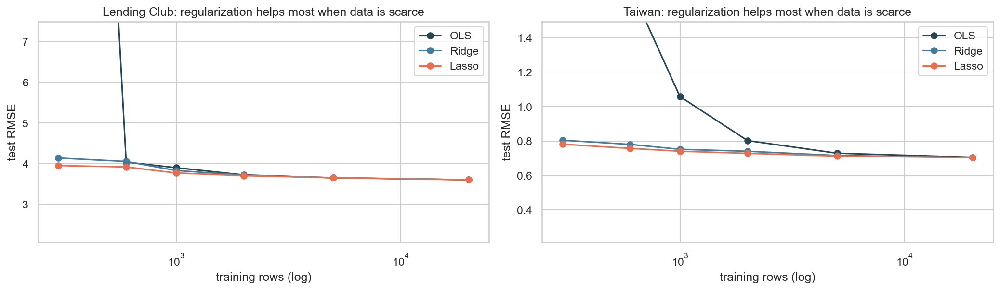
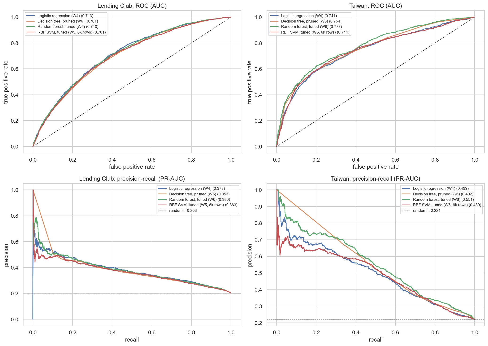
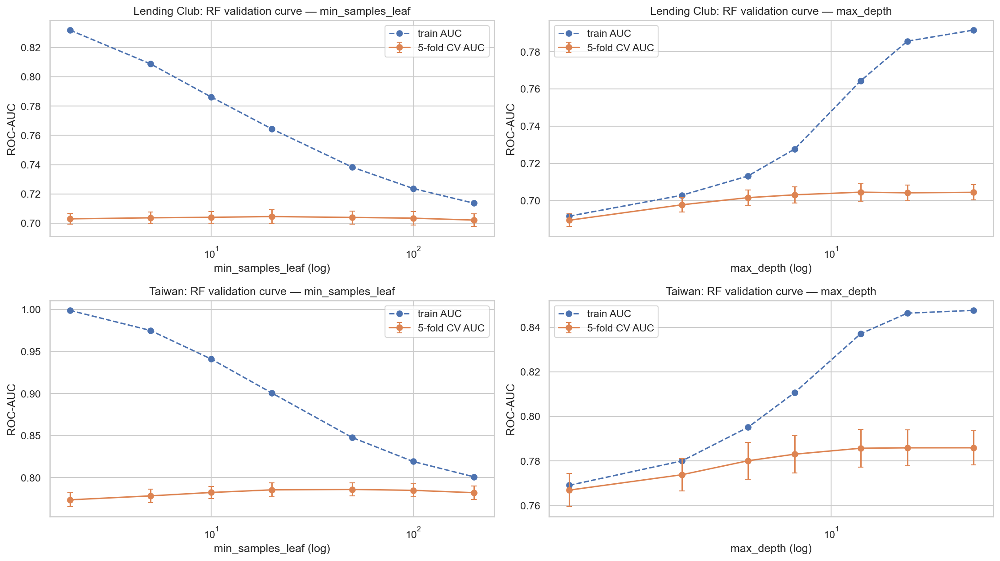
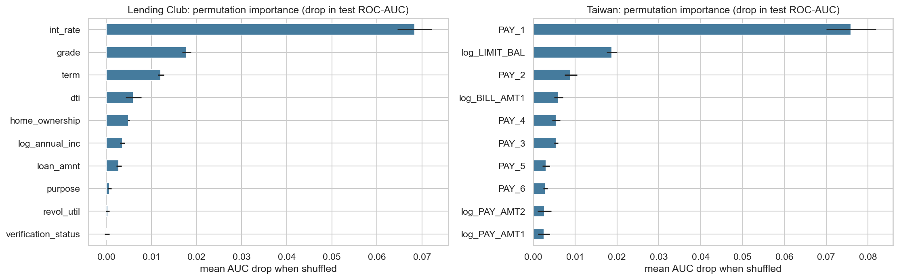

# Predicting Consumer Credit Default Across Two Markets: Milestone One

**Kumar Gaurav** · DX799 O1 Data Science Capstone (Fall 2026) · Boston University OMDS

**Depth models:** Random Forest (primary) and RBF-kernel Support Vector Machine (secondary). All six techniques are covered in Part 2a (Breadth); Part 2b (Depth) examines these two models.

## Part 1: Problem Statement

Consumer lenders lose money when borrowers default, and two of their main levers, the price of credit (interest rate) and its size (credit limit), are set to manage that risk. This project studies default risk in two contrasting markets: US peer-to-peer installment loans (Lending Club, 1.25 million closed loans, 2007–2018) and Taiwanese credit cards (UCI, 29,965 clients, 2005; Yeh & Lien, 2009). Weeks 1–3 model what lenders' risk decisions depend on (interest rate and credit limit), Weeks 4–6 predict default itself, and comparing the two markets tests whether the findings generalize. The models could support underwriting, risk-based pricing and limit setting, and early-warning flags on existing accounts. Because a missed default (lost principal) usually costs more than a declined good customer, evaluation prioritizes recall and the precision–recall trade-off over accuracy.

## Datasets and Project Setup

Both datasets (Kaggle / adarshsng, 2019; Kaggle / UCI Machine Learning, 2016) were audited before modeling with a data-quality block that opens every notebook (nulls, duplicates, impossible ranges, undocumented codes, leakage, target balance). From Lending Club's 2,260,668 raw loans I kept the 1,303,638 closed loans with a known outcome, removed invalid `dti` values and zero incomes, and dropped four post-outcome leakage columns such as `recoveries` ($0 for every repaid loan), leaving 1,254,818 loans with a 20.28% default rate. Taiwan had no missing values but 35 duplicates and some undocumented category codes (merged into "other"), leaving 29,965 clients with a 22.13% default rate. All classifiers share one stratified 80/20 split (a 60,000-loan Lending Club sample and all Taiwan clients, seed 42), so results are directly comparable. Models were fit with scikit-learn (Pedregosa et al., 2011) and statsmodels (Seabold & Perktold, 2010), following the methods in James et al. (2021).

## Part 2a: Breadth — All Six Techniques on Both Datasets

**Polynomial and interaction terms (Week 1).** On Lending Club's interest rate, squared and interaction terms (`dti²`, `dti × revol_util`, `income × term`) were significant (partial F = 125.0; p < 0.001) but negligible in practice: test RMSE moved from 3.938 to 3.932 percentage points. Adding `grade` lifted adjusted R² from 0.32 to 0.91 (RMSE 1.43), so Lending Club prices mainly through its own grade. On Taiwan's log credit limit, curvature mattered: `AGE²` raised adjusted R² from 0.187 to 0.224 (limits peak at age 47.4), and a categorical `PAY_1` raised it to 0.241 (RMSE 0.839 → 0.813). *Shortcoming:* raw polynomial terms were collinear (VIF 17.6 and 48.3) until centered (about 1.0–1.4).

**Ridge, lasso and elastic net (Week 2).** Degree-2 terms plus one-hot categoricals gave 108 (Lending Club) and 215 (Taiwan) features, with α tuned by 5-fold CV. With 111–185 rows per feature, regularization barely changed test RMSE (Lending Club: OLS 3.6037, ridge 3.6033, lasso 3.6031, elastic net 3.6030; Taiwan: OLS 0.7046, lasso 0.7033), although lasso dropped 62 of 215 Taiwan features at no cost. *Shortcoming:* on full data the gain is simplicity, not accuracy. Its value appears when data are scarce (Figure 1): with 300 training rows, OLS test RMSE exploded to 34.5 and 10.6 while lasso held at 3.95 and 0.78.

*Figure 1. Test RMSE vs number of training rows (log scale) for OLS, ridge and lasso on the expanded features. Regularization prevents the collapse of OLS when rows per feature are scarce.*

**Forward/backward selection, PCR and PLSR (Week 3).** On Lending Club, AIC-based forward and backward selection kept all 12 predictors and every method tied (test RMSE 4.2884–4.2888). On Taiwan, both directions dropped the redundant `BILL_AMT2` and `BILL_AMT3`. PCR needed 16 of 25 components to come within 1% of the OLS CV error, while PLSR needed only 3 because it builds components using the target. *Shortcoming:* none beat OLS on accuracy (Taiwan test RMSE spread 0.0028); with 24,000 rows, estimation variance was already small.

**Logistic regression and feature scaling (Week 4).** Standardization mainly changed convergence: iterations fell from over 1,000 (not converged) to 55 on Lending Club, with ROC-AUC rising only from 0.691 to 0.700, and from 554 to 31 on Taiwan with ROC-AUC unchanged (0.740). At the 0.5 threshold the unweighted model caught only 6% of Lending Club defaults (F1 0.11); balanced class weights raised recall to 0.68 and F1 to 0.44 with ROC-AUC unchanged. Test ROC-AUC was 0.713 (Lending Club) and 0.741 (Taiwan). *Shortcoming:* a linear boundary cannot capture threshold effects in repayment status.

**Support vector machines (Week 5).** The original C sweep showed C = 100 overfitting (train accuracy 0.897 vs test 0.573), but it chose C on the test set, so I replaced it with a cross-validated grid (Part 2b). The tuned RBF-SVM reached test ROC-AUC 0.701 and 0.744. *Shortcoming:* 84% and 68% of training rows became support vectors, so the model had to be fit on a 6,000-row subsample.

**Decision trees and random forests (Week 6).** A single tree peaked at depth 5–6 (CV AUC 0.690 / 0.759); an unlimited tree reached training AUC 1.000 but CV AUC only 0.541 / 0.606. Cost-complexity pruning found 19–24-leaf trees that matched or beat depth limits. The depth-3 Taiwan tree splits first on `PAY_1 ≤ 1.5`, isolating the 10.5% of clients two or more months late, about 70% of whom default. *Shortcoming:* single trees are unstable and coarse; forests fix both at the cost of interpretability and compute.

**Final comparison.** On Lending Club all four classifiers fall within 0.012 ROC-AUC; on Taiwan the random forest leads on every threshold-free metric (Table 1, Figure 2).

*Table 1. Held-out test performance on the shared splits (Lending Club n = 12,000; Taiwan n = 5,993). Thresholds maximize F1 on out-of-fold training predictions; the SVM uses its margin boundary. Baselines: ROC-AUC 0.5; PR-AUC = default rate (0.203 / 0.221).*

| Dataset | Model | ROC-AUC | PR-AUC | Precision | Recall | F1 |
|---|---|---|---|---|---|---|
| Lending Club | Logistic regression | **0.713** | 0.378 | 0.324 | 0.653 | 0.433 |
| Lending Club | Decision tree (pruned) | 0.701 | 0.353 | 0.301 | 0.711 | 0.423 |
| Lending Club | Random forest (tuned) | 0.710 | **0.380** | 0.319 | 0.674 | **0.433** |
| Lending Club | RBF SVM (tuned, 6k rows) | 0.701 | 0.363 | 0.336 | 0.605 | 0.432 |
| Taiwan | Logistic regression | 0.741 | 0.499 | 0.463 | 0.569 | 0.511 |
| Taiwan | Decision tree (pruned) | 0.755 | 0.492 | 0.487 | 0.546 | 0.515 |
| Taiwan | Random forest (tuned) | **0.773** | **0.551** | 0.510 | 0.554 | **0.531** |
| Taiwan | RBF SVM (tuned, 6k rows) | 0.744 | 0.489 | 0.450 | 0.595 | 0.512 |

*Figure 2. Test-set ROC curves (top) and precision–recall curves (bottom). The Lending Club curves nearly overlap; on Taiwan the random forest (green) dominates, especially at high precision.*

## Part 2b: Depth — Random Forest (primary) and RBF SVM (secondary)

### Random forest

I treat the random forest in depth because it was the best model on Taiwan and tied for best on Lending Club. `RandomizedSearchCV` sampled 20 combinations of `n_estimators` {150, 300}, `max_depth` {8, 12, 16, None}, `min_samples_leaf` {5, 20, 50, 100}, `max_features` {sqrt, 0.3} and `class_weight`, scored by 5-fold stratified ROC-AUC. I used random rather than grid search because only a few hyperparameters usually matter (Bergstra & Bengio, 2012) and fully grown forests were slow to fit. The Lending Club winner used 300 trees, depth 12, leaves of at least 20 and √p features (CV AUC 0.7047 ± 0.0049); the Taiwan winner used 300 trees, unlimited depth, leaves of at least 50 and 30% of features (0.7864 ± 0.0077). Both stop individual trees from memorizing borrowers, one with a depth cap and one with a leaf-size floor, and the top five candidates on each dataset lie within 0.001 AUC, so the forest is robust once extreme memorization is avoided.

The validation curves (Figure 3) show the bias–variance mechanism. Shrinking leaves from 200 rows to 2 raises training AUC from 0.71 to 0.83 (Lending Club) and from 0.80 to 0.999 (Taiwan), while validation AUC barely moves (0.703–0.705 and 0.774–0.786). Variance grows in the individual trees but is averaged away (Breiman, 2001): unlimited depth cost a single tree about 0.15 AUC, but the most overfit forest lost under 0.01. The out-of-bag estimate matched CV (0.7029 vs 0.7047; 0.7864 vs 0.7864), and test AUC (0.710, 0.773) fell within 1.7 fold-SDs of CV, so tuning did not overfit the folds.

*Figure 3. Random-forest validation curves: train AUC (dashed) vs 5-fold CV AUC (solid, ±1 SD) for `min_samples_leaf` (left) and `max_depth` (right). The widening gap is variance that averaging over trees absorbs.*

Permutation importance on the test set (Figure 4) agrees with impurity importance on the leaders: `int_rate` on Lending Club (AUC drop 0.068) and `PAY_1` on Taiwan (0.076). Below them, impurity favors continuous features with many split points (`dti`, income), whereas permutation ranks grade (0.018) and term (0.012) next and shows the correlated `PAY_2`–`PAY_4` add little once `PAY_1` is known (0.003–0.009), the collinearity seen in Week 3. In domain terms, Lending Club's risk is already priced into the rate and grade, while Taiwan's is behavioural, with a sharp threshold (13–17% default when paid duly, 69% at two months late) that trees capture and linear models cannot. That is why the forest gains +0.032 ROC-AUC and +0.051 PR-AUC over logistic regression on Taiwan and nothing on Lending Club.

*Figure 4. Permutation importance of the tuned random forests (mean drop in test ROC-AUC, 5 repeats, error bars = SD). One feature dominates each market.*

### RBF support vector machine

The SVM is the clearest test of regularization (C) and the kernel trick (γ). A 5-fold stratified grid over a linear kernel and an RBF kernel (C from 0.01 to 100 × γ ∈ {scale, 0.01, 0.1, 1}) was run on a 6,000-row stratified subsample, because kernel SVM cost grows roughly with n². The winners were C = 0.1, γ = 0.01 on Lending Club (CV AUC 0.6823 ± 0.0110) and C = 1, γ = 0.01 on Taiwan (0.7620 ± 0.0085): a wide kernel and a soft margin, giving a smooth, nearly linear boundary. Large C and γ drove training AUC to 1.000 while CV AUC fell to about 0.59 and 0.64. The kernel bought nothing on Lending Club (linear SVM CV 0.6807) and a little on Taiwan. Because 84% and 68% of rows were support vectors, the classes overlap so heavily that the SVM loses its usual sparsity, and its test AUC (0.7014, 0.7443) is below or level with logistic regression on the same 6,000 rows (0.7087, 0.7415), which explains why the kernel trick fails to help here.

## Part 3: Overfitting

Every model was scored once on a held-out stratified 20% test set after all choices were made, and selection inside the training data used 5-fold stratified CV, because with only 20–22% positives a single validation split could misrepresent defaults (fold SDs of 0.004–0.016 AUC show how far one split could mislead). Polynomial models were judged by adjusted R², AIC and test RMSE rather than training R², which always rises with added terms. Ridge, lasso and elastic net chose α by CV, and the 300-row experiment shows why the penalty matters. Stepwise selection used AIC's per-parameter penalty, and PCR/PLS chose components by CV. Logistic regression cross-validated C and the penalty and set its threshold on out-of-fold predictions, not the test set. The original SVM notebook picked C on the test set, a mild leak, so I replaced it with CV over C and γ. Trees used CV-chosen depth and cost-complexity pruning because an unpruned tree scored 1.000 training AUC but 0.54 CV AUC; forests added bootstrap averaging, feature subsampling and leaf-size floors, with OOB and CV agreeing within 0.002. Every tuned model's test score fell within about two fold-SDs of its CV estimate, which is the evidence that these safeguards worked.

## Part 4: Metrics and Hyperparameter Tuning

For regression I used RMSE because it is in the target's units (percentage points of interest; log credit limit) and compares directly with the target SD (4.79 and 0.94). For classification, accuracy is misleading at a 20% default rate, where predicting "no default" already scores about 80%. I therefore reported ROC-AUC (threshold-free ranking, which underwriting cut-offs rely on), PR-AUC (focused on the minority class, with a baseline equal to the default rate), and recall and F1 (a missed default is the costly error, and F1 balances it against false alarms). Thresholds maximized F1 on out-of-fold predictions (0.46–0.58). Tuning was concentrated on the depth models (Part 2b): randomized search for the forest and a grid over kernel, C and γ for the SVM. Logistic regression got only a small C × penalty grid to confirm it was flat, the single tree a depth and `ccp_alpha` sweep, and the Week 1–3 baselines were deliberately left at defaults apart from the α and k that define those methods. The chosen values describe the data: forest leaves of 20–50 rows mean individual borrowers are noisy and risk must be pooled, a small SVM γ means the useful boundary is smooth, and Taiwan's strong logistic penalty (C = 0.001) means its correlated repayment and bill months can be shrunk heavily at no cost.

## Part 5: Exploratory Data Analysis

EDA drove the main modeling choices. Income was extremely right-skewed (skew 47.6, maximum $11M), falling to 0.21 after `log1p`, so incomes, limits and a signed log of bill and payment amounts entered the models in log form. Lending Club predictors were only mildly correlated (maximum VIF 2.51), so I expected little from regularization there, whereas Taiwan's six monthly bills correlate at 0.80–0.95 with repayment-status VIFs up to 7.1, which made Taiwan the fair test for ridge, lasso, PCR and PLS. Default rates of 20–22% led me to score classifiers with ROC-AUC, PR-AUC, F1 and recall, to stratify splits and folds, and to use balanced class weights. The very different scales of features such as `loan_amnt` (up to $40,000) and `dti` (0–100) meant every distance- or penalty-based model was standardized inside a pipeline. Finally, the jump in Taiwan's default rate from 13–17% for on-time payers to 69% for clients two months late set the expectation that tree models would exploit `PAY_1` thresholds, which Part 2b confirmed.

## Part 6: Expected vs. Unexpected Results

Several results matched expectations: `PAY_1` and the interest rate or grade dominated every model, as the EDA suggested; unpruned trees and high-C, high-γ SVMs memorized the training data; and class weighting fixed the near-zero recall. The biggest surprise was that flexibility helped in only one market. I expected the random forest to beat logistic regression on both datasets, but on Lending Club four very different model families finished within 0.012 AUC, and plain logistic regression had the highest ROC-AUC. My explanation is that Lending Club's application data carries a roughly linear signal already summarized in the price, so the ceiling is the information available at application time, not the model; Taiwan's payment history has threshold structure, so flexibility paid off there. I was also surprised that regularization and dimension reduction did not change accuracy even on collinear Taiwan; only the 300-row experiment revealed regularization's value, a reminder that "best practice" depends on sample size. Finally, a depth-3 tree reached about 97% of the tuned tree's test AUC with eight readable rules, which may matter more to a credit committee than the last 0.01 AUC. The next milestone will address the main limitations (a random rather than out-of-time split, uncalibrated probabilities and no explicit cost model) with time-based validation, calibration curves and a cost-weighted threshold.

## References

Bergstra, J., & Bengio, Y. (2012). Random search for hyper-parameter optimization. *Journal of Machine Learning Research, 13*, 281–305.

Breiman, L. (2001). Random forests. *Machine Learning, 45*(1), 5–32. https://doi.org/10.1023/A:1010933404324

James, G., Witten, D., Hastie, T., & Tibshirani, R. (2021). *An introduction to statistical learning with applications in R* (2nd ed.). Springer.

Kaggle / adarshsng. (2019). *Lending Club loan data* [Data set]. Kaggle. https://www.kaggle.com/datasets/adarshsng/lending-club-loan-data-csv

Kaggle / UCI Machine Learning. (2016). *Default of credit card clients dataset* [Data set]. Kaggle. https://www.kaggle.com/datasets/uciml/default-of-credit-card-clients-dataset

Pedregosa, F., et al. (2011). Scikit-learn: Machine learning in Python. *Journal of Machine Learning Research, 12*, 2825–2830.

Seabold, S., & Perktold, J. (2010). Statsmodels: Econometric and statistical modeling with Python. *Proceedings of the 9th Python in Science Conference*, 92–96.

Yeh, I.-C., & Lien, C.-H. (2009). The comparisons of data mining techniques for the predictive accuracy of probability of default of credit card clients. *Expert Systems with Applications, 36*(2), 2473–2480. https://doi.org/10.1016/j.eswa.2007.12.020

## Appendix A: AI Use Statement

**Did I use AI?** Yes. I used an AI coding assistant (Cursor's agent, powered by Anthropic's Claude) for this milestone.

**Prompts and purposes.**

* *"Here is my 6 weeks homework, my capstone-req.md and rubric… help me analyze what is missing in my homework."* Purpose: compare my notebooks with the requirements. It found the invalid Week 1 AML results, the empty Week 2 and Week 5 files, the missing Week 6, and that no hyperparameter search used cross-validation.
* *"Can we find a new dataset for loan default… the paper needs one framing."* Purpose: replace the AML dataset so both datasets share one problem. I chose the UCI Taiwan data from the options offered.
* *"Ensure in each notebook basic checks are done as a human like data quality evaluation, null columns check etc."* Purpose: build the shared data-quality block.
* *"Implement the plan…"* Purpose: the AI wrote and executed new notebook cells (Weeks 1, 2 and 6, plus additions to Weeks 3–5) and drafted explanatory markdown and this report from the executed outputs.
* *"Can you confirm presentation is following the template mentioned in capstone.md… fix above observations."* Purpose: check this report against the milestone guidelines and revise its structure and length.

**What I did myself.** I chose the framing, the datasets and the depth models, reviewed each notebook's outputs, revised the notebook explanations in the final (`_v2`) versions, and checked that every number in this report matches an executed notebook cell.

**Reflection.** AI made it practical to run every technique on two datasets with proper cross-validation. Its main risk is confident wording that runs ahead of the evidence, which I mitigated by requiring every interpretation to quote executed output and by reporting results that did not support my hypotheses, such as the Lending Club tie.

## Appendix B: Notebooks

The executed notebooks are submitted as one combined PDF. Each opens with the same data-quality block and runs on its own.

* **Week 1:** `week_08282026/DX799O1/homework/kumar_gaurav_week1_dx799O1_v2.ipynb`, covering polynomial/interaction terms and VIF.
* **Week 2:** `week_09042026/DX799O1/homework/kumar_gaurav_week2_dx799O1_v2.ipynb`, covering ridge, lasso and elastic net.
* **Week 3:** `week_09112026/DX799O1/homework/kumar_gaurav_week3_dx799O1_v2.ipynb`, covering stepwise selection, PCR and PLSR.
* **Week 4:** `week_09182026/DX799O1/homework/kumar_gaurav_week4_dx799O1_v2.ipynb`, covering logistic regression, scaling, class weights, CV tuning and thresholds.
* **Week 5:** `week_09252026/DX799O1/homework/kumar_gaurav_week5_dx799O1_v2.ipynb`, covering SVMs and the CV grid over kernel, C and γ.
* **Week 6:** `week_10022026/DX799O1/homework/kumar_gaurav_week6_dx799O1_v2.ipynb`, covering decision trees, random forests and the final comparison.

Supplementary figures not used in the body (the PCR/PLS CV curve, SVM C/γ curve, α curves, lasso paths, threshold curves, tree-depth curves and depth-3 trees) are in `figures/supplementary/`.
