# Homework Reflections 5–8

**Student:** Gaurav Kumar
**Course:** DX702O1

---

## (Week 5)

### Question 1

> Draw a diagram for the following negative feedback loop:
> Sweating causes body temperature to decrease. High body temperature causes sweating.
> A negative feedback loop means that one thing increases another while the second thing decreases the first.
> Remember that we are using directed acyclic graphs where two things cannot directly cause each other.

A direct drawing of this loop would be Temperature → Sweating → Temperature, which is a cycle, and a DAG cannot have two variables cause each other. I removed the cycle by indexing each variable by time. High body temperature at time t increases sweating at time t (a positive edge). Sweating at time t then decreases body temperature at the next time step, t+1 (a negative edge). I also added an edge Temp(t) → Temp(t+1), because body temperature carries over from one moment to the next.

The feedback is negative because the two edges in each round have opposite signs: (+) × (−) = (−). If temperature rises, sweating rises, which pushes the next temperature back down. This stabilizes the system around a set point, which is how the body maintains homeostasis. Every arrow points forward in time, so the graph is acyclic; I confirmed this with `networkx.is_directed_acyclic_graph`.

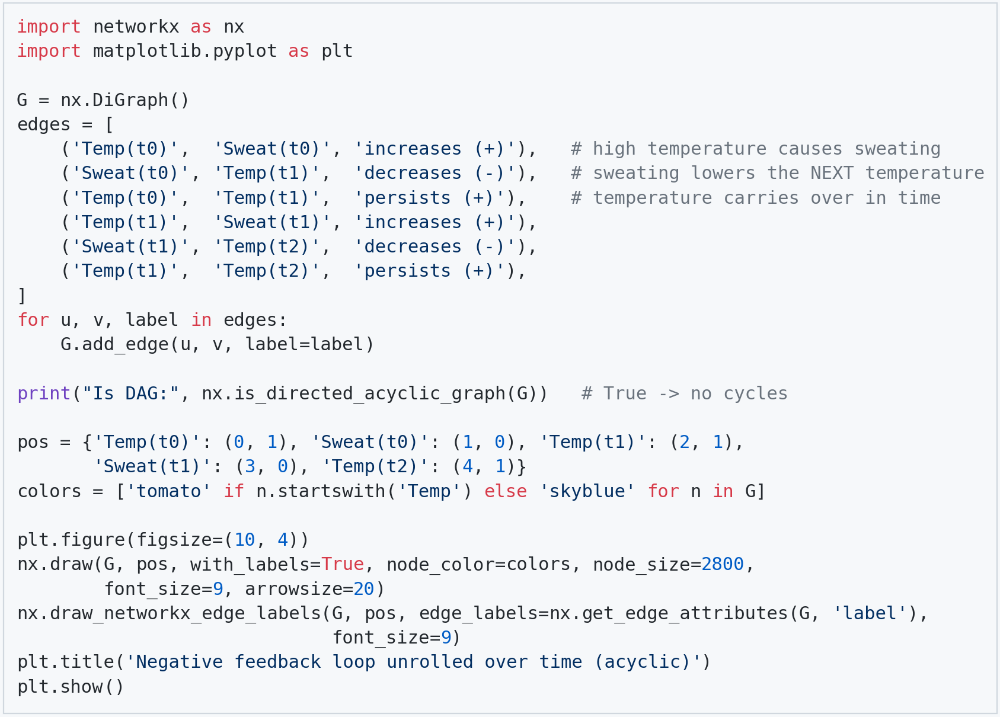

---

### Question 2

> Describe an example of a positive feedback loop. This means that one thing increases another while the second thing also increases the first.

A classic positive feedback loop is the ice–albedo effect in climate. Ice and snow are bright and reflect most incoming sunlight back to space. When global temperature rises, some ice melts and exposes darker ocean or land underneath. Darker surfaces absorb more sunlight, which raises temperature further, which melts more ice. Each variable increases the other: Temperature → (+) Ice melt, and Ice melt → (+) Temperature.

As with the sweating example, this can't be drawn as Temperature ⇄ Ice melt in a DAG, because two variables cannot directly cause each other. So I unrolled it over time: Temp(t) → IceMelt(t) → Temp(t+1). Both edges are positive, so the product of signs is (+) × (+) = (+), and a small push grows instead of fading. That is the key contrast with Question 1: negative feedback (sweating) pulls the system back to a set point, while positive feedback amplifies a change until something outside the loop stops it. Here, that limit is running out of ice.

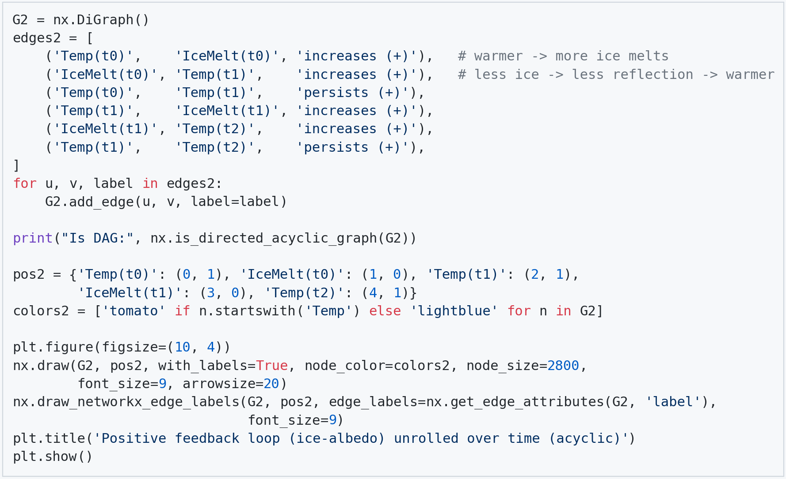

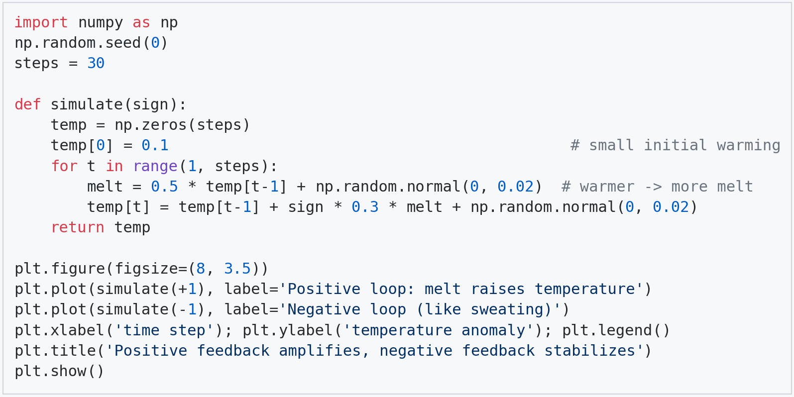

---

### Question 3

> Draw a diagram for the following situation:
> Lightning storms frighten away deer and bears, decreasing their population, and cause flowers to grow, increasing their population.
> Bears eat deer, decreasing their population.
> Deer eat flowers, decreasing their population.
> Write a dataset that simulates this situation. (Show the code.) Include noise / randomness in all cases.
> Identify a backdoor path with one or more confounders for the relationship between deer and flowers.

The diagram has three paths between Deer and Flowers. The direct causal path is Deer → Flowers (deer eat flowers). The main backdoor path is Deer ← Lightning → Flowers, where Lightning is a confounder: storms lower the deer population and also raise the flower population. A second backdoor path is Deer ← Bears ← Lightning → Flowers. Both backdoor paths run through Lightning.

In the simulation, the true effect of one more deer is −0.8 flowers. A naive regression of flowers on deer gives about −1.72, more than double the true effect. That's because in seasons with few deer there were usually many storms, and storms also raise flower counts, so deer look more harmful than they are. Adding lightning to the regression closes both backdoor paths and gives about −0.73, close to the true −0.8. Controlling for bears alone does not help (−1.80), because the path Deer ← Lightning → Flowers is still open.

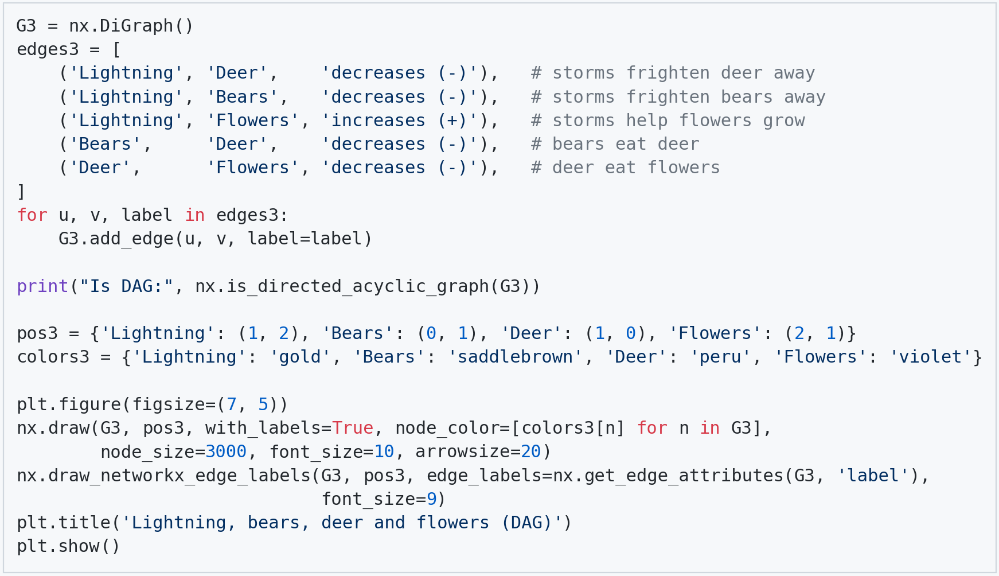

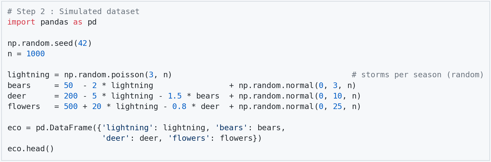

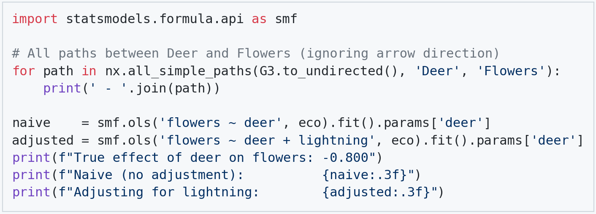

---

### Question 4

> Draw a diagram for a situation of your own invention. The diagram should include at least four nodes, one confounder, and one collider. Be sure that it is acyclic (no loops). Which node would you say is most like a treatment (X)? Which is most like an outcome (Y)?

My example asks whether attending **tutoring** raises a student's **exam score**. The graph has five nodes. **Motivation** is the confounder: motivated students are more likely to sign up for tutoring (Motivation → Tutoring), and they also score higher on their own (Motivation → ExamScore). That makes a backdoor path, Tutoring ← Motivation → ExamScore. **StudyHours** is a mediator on the real causal path: Tutoring → StudyHours → ExamScore. **Honors** (admission to an honors program) is the collider: a student can get in through a tutor's recommendation or through a high exam score, so two arrows point into it (Tutoring → Honors ← ExamScore). Every arrow goes forward from cause to effect and none returns to an earlier node, so the graph is acyclic. `nx.is_directed_acyclic_graph` confirms this.

**Tutoring is the treatment (X)**, because it is the choice or intervention we would like to evaluate. **ExamScore is the outcome (Y)**, because it is the downstream result we care about. Motivation and Honors are neither. Motivation is a common *cause* of X and Y, and Honors is a common *effect* of X and Y.

The two special nodes need opposite handling. To remove confounding bias, we **should control for the confounder** (Motivation), which blocks the backdoor path. We **should not control for the collider** (Honors). A collider blocks its path on its own, but conditioning on it opens that path. For example, among honors students only, someone who got in without a high score most likely got in through tutoring. This creates a false negative link between tutoring and score. The simulation below shows both effects. The true effect is 6 points. The naive estimate is about 11 because motivation inflates it. Controlling for Motivation gives about 6. Adding Honors as a control, or keeping only honors students, pulls the estimate down to about 3.

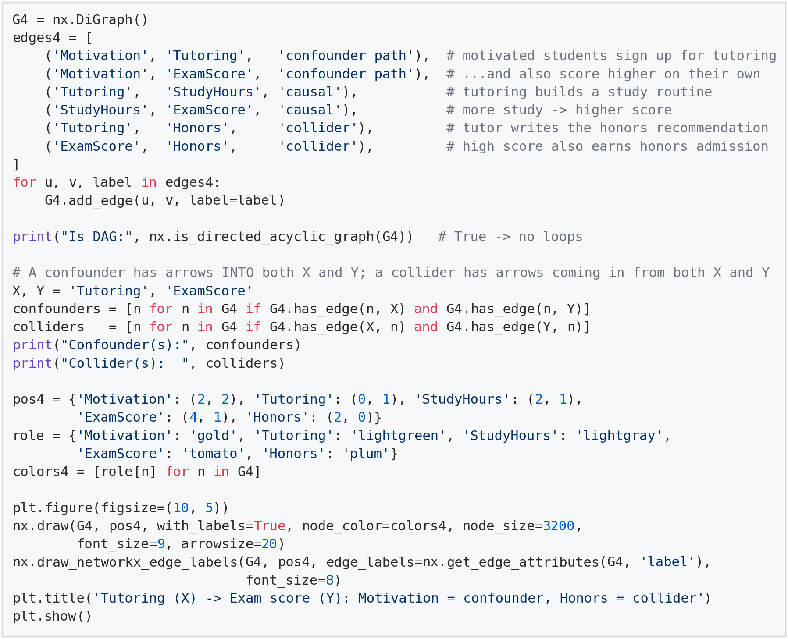

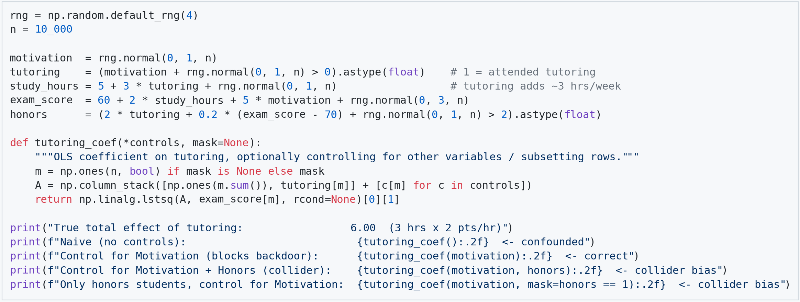

---

## (Week 6)

### Question 1

> What is a potential problem with computing the Marginal Treatment Effect simply by comparing each untreated item to its counterfactual and taking the maximum difference? (Hint: think of statistics here. Consider that only the most extreme item ends up being used to estimate the MTE. That's not necessarily a bad thing; the MTE is supposed to come from the untreated item that will produce the maximum effect. But there is nevertheless a problem.)

The problem is that the maximum of many noisy estimates is a biased and unstable statistic. Each student's estimated effect, Y(1) − Y(0), equals their true effect plus random noise. When we take the maximum over thousands of students, we pick whoever had the most extreme noise draw, not necessarily the person with the largest true effect. This is the "winner's curse" (also called regression to the mean, or a multiple-comparisons problem): the more items we compare, the more likely one of them looks extreme purely by chance.

I demonstrated this with the tutoring model from Week 5, where tutoring raises every student's score by exactly 6 points, so the true marginal treatment effect is 6. Yet the largest estimated effect among 4,912 untreated students was 23.6, almost four times the truth. Across 200 reruns, the maximum ranged from 21.4 to 29.9, so the estimate also has high variance. The maximum also keeps growing with sample size (about 17.7 at n = 100 and 27.2 at n = 100,000) even though the true effect never changes. A useful estimator should converge to the true value as we collect more data; the maximum moves away from it.

So the naive MTE is driven by a single noisy observation. It is biased upward, sensitive to sample size, and not reproducible. If we targeted that "most responsive" student, their next outcome would most likely fall back toward 6. A more robust approach is to estimate a high quantile of the effect distribution, or to average the top group of students, instead of relying on one extreme point.

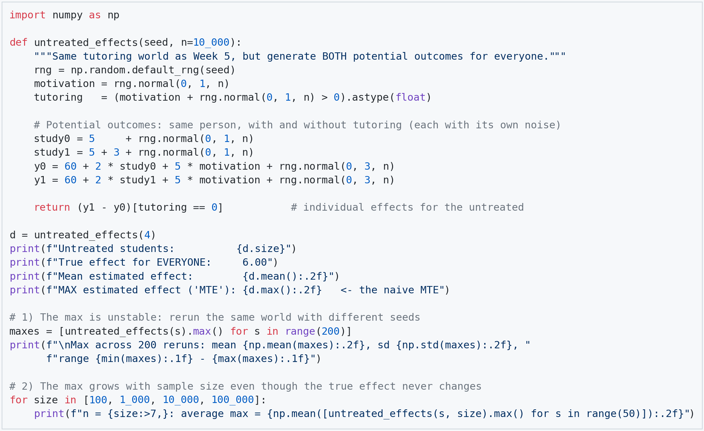

---

### Question 2

> Propose a solution that remedies this problem and write some code that implements your solution. It's very important here that you clearly explain what your solution will do.

My solution replaces the maximum estimated effect with the **90th percentile** of the estimated effects across all untreated items. The code works like this. It creates 200 untreated items, each with a fixed true treatment effect. In each of 1,000 repetitions, it estimates each item's counterfactual with noise (SD = 1), just as a real model would. Each repetition then records two summaries: the largest estimated effect (the original MTE method) and the 90th percentile of the estimated effects (my proposal). Because I know the true effects, I can measure how far off each method is on average (bias) and how much it jumps around between repetitions (SD).

The results show the problem from Question 1. The max of the estimates averages 5.96, while the true MTE is 5.05, so it overshoots by about 0.9. That's because the item that "wins" is usually one whose noise happened to be large and positive. The max is also unstable (SD = 0.56), because it depends on a single item. The 90th percentile is an order statistic in the middle of the upper tail, so it combines information from many items and no single lucky draw controls it. Its SD is 0.15, almost four times smaller.

The trade-off is that the 90th percentile answers a slightly different question: "what effect would a high-response item get?" rather than "what is the largest effect?" It is still a little inflated (+0.57), because noise spreads out the whole distribution of estimates. A further fix would be to first shrink each estimate toward the overall mean, based on how noisy it is, and then take the percentile. For a decision such as "which untreated items should we treat next?", a stable estimate for the top 10% is more useful than an unreliable estimate for the single best item.

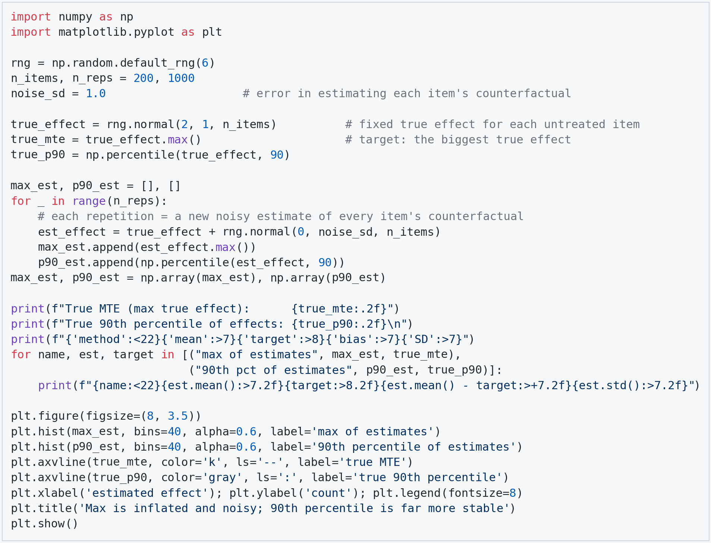

---

## (Week 7)

### Question 1

> Create a linear regression model involving a confounder that is left out of the model. Show whether the true correlation between X and Y is overestimated, underestimated, or neither. Explain in words why this is the case for the given coefficients you have chosen.

I simulated a confounder W that causes both the treatment and the outcome: X = 0.8·W + noise and Y = 2·X + 3·W + noise. The true effect of X on Y is 2. When W is included in the regression, the X coefficient is 1.98, which matches the truth. When W is left out, the X coefficient jumps to 3.46, so the effect is **overestimated** by about 73%.

The reason is that X and W move together (W raises X by 0.8 for each unit of W). Once W is removed from the model, the regression gives X credit for W's effect on Y, because high-X units also tend to have high W. The omitted-variable bias formula states this exactly: bias = (effect of W on Y) × Cov(X, W)/Var(X) = 3 × 0.8/1.64 ≈ 1.46, and 2 + 1.46 = 3.46, which matches the simulation.

The direction of the bias depends on the signs. Here both of W's effects are positive (W raises X and raises Y), so the bias is positive and X looks more effective than it is. If I change W's effect on Y to −3, the two signs disagree and the X coefficient drops to 0.54, an underestimate. Only when W is unrelated to X, or has no effect on Y, does leaving it out cause no bias.

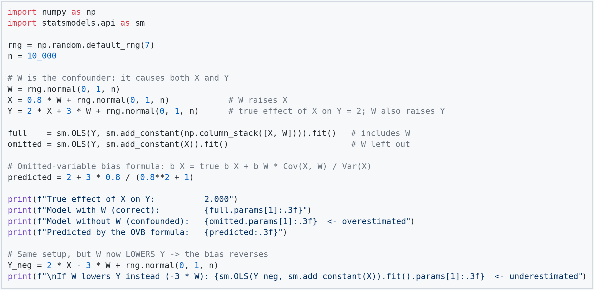

---

### Question 2

> Perform a linear regression analysis in which one of the coefficients is zero, e.g.
> W = [noise]
> X = [noise]
> Y = 2 * X + [noise]
> And compute the p-value of a coefficient — in this case, the coefficient of W.
> Run the analysis 1000 times and report the best (smallest) p-value.
> If the p-value is less than 0.05, does this mean the coefficient actually is nonzero? What is the problem with repeating the analysis?

I simulated W and X as independent standard-normal noise, with Y = 2X + noise and n = 100. That means the true coefficient on W is exactly zero. I then fit the regression Y ~ W + X 1,000 times, each time on fresh data, and recorded the p-value for W's coefficient. The **smallest p-value was 0.0028**, with an estimated W coefficient of +0.31. Taken alone, that looks like strong evidence that W affects Y. In addition, 46 of the 1,000 runs (4.6%) had p < 0.05.

**No, a p-value below 0.05 does not mean the coefficient is actually nonzero.** We know the truth here: W has no effect on Y. A p-value is the probability of an estimate at least this extreme *assuming* the true coefficient is zero. So when the null hypothesis is true, p-values are uniformly distributed between 0 and 1, which is what the flat histogram shows. About 5% of runs will fall below 0.05 purely by chance; these are false positives (Type I errors). The 0.05 threshold controls the error rate for **one** pre-planned test, not for the best of many tests.

The problem with repeating the analysis is **multiple testing**, also called p-hacking. Each run has a 5% chance of a false positive. The chance that *none* of the 1,000 runs falls below 0.05 is 0.95^1000 ≈ 5 × 10⁻²³. So reporting the smallest p-value almost guarantees a "significant" result, even when there is no effect at all. The same thing happens in practice when someone tries many specifications, subgroups, or datasets and reports only the one that worked. A fix is to pre-register a single test, or to correct for the number of tests. For example, with a Bonferroni correction (0.05 / 1000 = 0.00005), none of the 1,000 runs is significant, which is the correct conclusion.

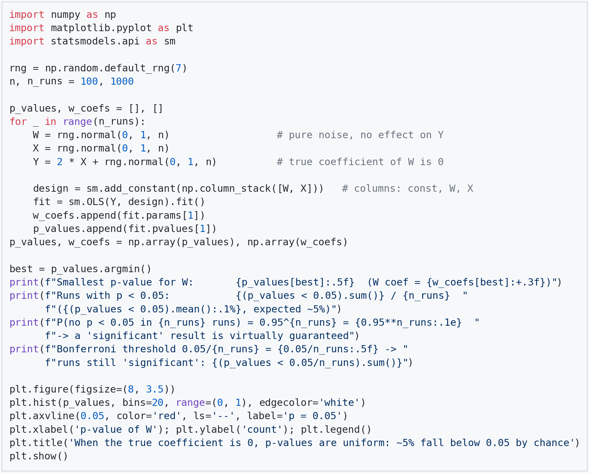

---

## (Week 8)

### Question 1

> Include the code you used to solve Week 8's coding quiz problems and write about the obstacles / challenges / insights you encountered while solving them.

**Approach and choices.** For Questions 1–2 of the quiz, I estimated the ATE with inverse probability weighting. A logistic regression of X on Z gave each row's propensity score p = P(X=1 | Z), and each row was weighted by 1/p if treated or 1/(1−p) if untreated. I made three choices. First, I set `C=np.inf` to turn off scikit-learn's default L2 penalty, which shrinks coefficients and pulls the scores toward 0.5; we want the plain probability here. Second, I used normalized (Hájek) weighted means via `np.average` rather than the unnormalized Horvitz-Thompson formula, because normalized weights are more stable when a few weights are large. Third, I checked overlap before trusting the result. The IPW ATE was **≈ 2.27**, compared with a naive difference of 3.04. The first three propensity scores were **0.842, 0.585, 0.712**. For quiz Questions 3–4, I matched each treated row to its nearest untreated row by Mahalanobis distance, with replacement, which gave an **ATT ≈ 3.44** compared with a naive 4.05. The treated item with the least common support had (Z1, Z2) = (2.696, 0.538), and its nearest untreated neighbor was (1.520, −1.282) at a Mahalanobis distance of 1.383.

**Obstacles.** The main pitfall was the covariance matrix. `np.cov` treats each *row* as a variable, so passing an N × 2 DataFrame silently returns a 1000 × 1000 matrix. I had to stack Z1 and Z2 into a 2 × N array to get the 2 × 2 covariance, then invert it. A second subtle point: "with replacement" needed no extra code. Each treated row searches all controls and nothing is ever removed, so a control can be reused. For Question 4, I first used the overall largest distance, but "least common support" means the treated row whose *nearest* control is farthest away, so I had to store the *minimum* distance per treated row and then take the maximum. Finally, the default regularization was a hidden choice I only noticed when I compared it with the unpenalized fit; it turned out to matter very little (2.274 vs 2.268).

**Insights.** Both methods pulled the estimate down from the naive difference. That's because Z (or Z1 and Z2) raises both the chance of treatment and the outcome, so the treated group would have had higher Y anyway. Reweighting and matching both make the groups comparable on Z, but they answer slightly different questions. IPW with these weights estimates the **ATE** over everyone, while matching treated rows to controls estimates the **ATT**, the effect on those who were actually treated. Checking robustness was useful too: three IPW variants landed between 2.24 and 2.27, which gave me confidence in the result. The overlap check was also reassuring: scores were between 0.05 and 0.93 and the largest weight was about 13, so no single row dominated. Both methods still rely on the same untestable assumption, that the measured Z's capture all the confounding.

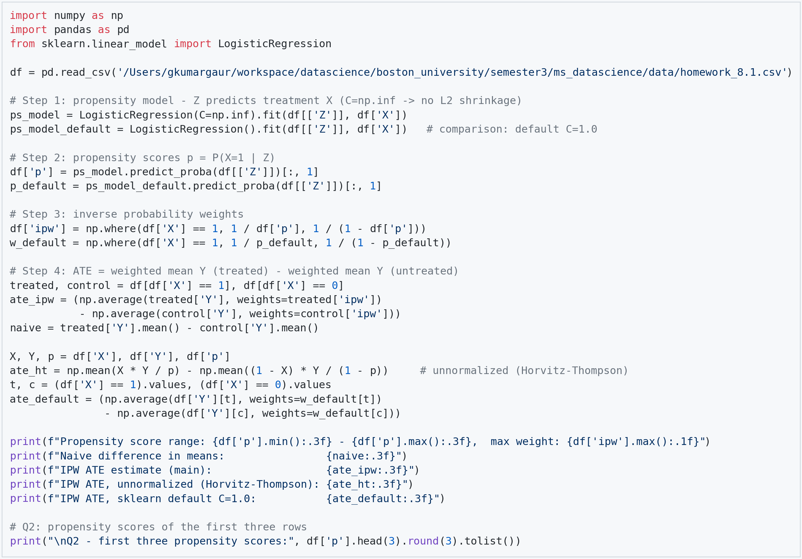

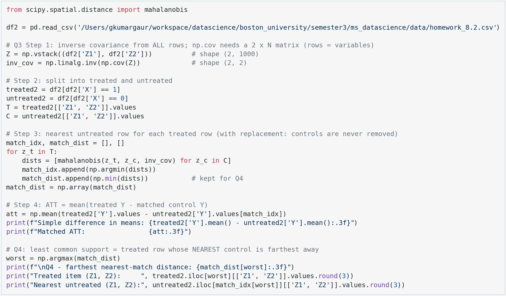
